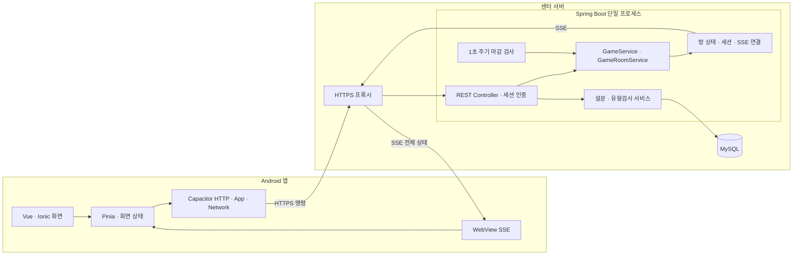
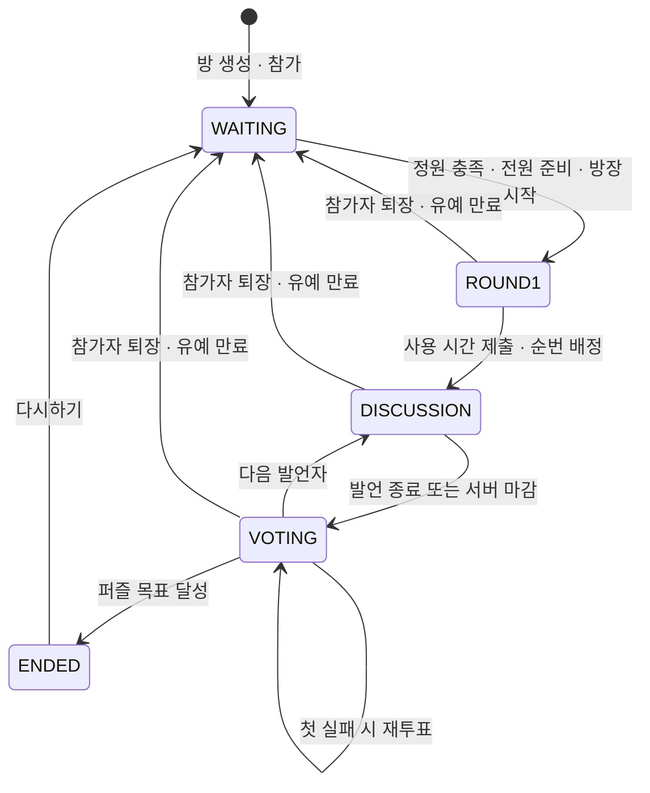

# 수햇 · Suhat

> 스마트폰 사용 습관을 돌아보고, 카드 이야기와 퍼즐 게임으로 함께 대화하는 모바일 서비스.

수햇은 이용습관 설문, 사용 유형 검사, 1인 게임과 3~4인 보드게임을 제공하는 Android 앱과 서버다. 여러 참가자가 같은 방에서 카드에 대한 이야기를 나누고 투표하며 퍼즐 조각을 모은다.

| 기능 | 설명 |
|---|---|
| 이용습관 설문 | 문항 응답과 점수 저장 |
| 사용 유형 검사 | 서비스 유형별 문항을 풀고 결과 설명·제안 확인 |
| 1인 게임 | 앱에 포함된 카드·매칭 데이터로 진행 |
| 다인 게임 | 방 생성·바코드 참가, 발언 순서, 카드 선택, 투표, 퍼즐·순위 |
| 모바일 복구 | 백그라운드·네트워크 단절 후 현재 게임 상태로 복귀 |

이 저장소는 **Android 앱과 웹 프론트엔드**다. 서버 소스는 [suhat-backend](https://github.com/donghyeon0619/suhat-backend)에 있다.

[전체 구조](#전체-아키텍처) · [앱 구조](#앱-구조) · [실행](#실행) · [모바일 검증](docs/mobile-validation.md) · [개발 규칙](CONTRIBUTING.md)

## 기술 스택

| 영역 | 기술 | 역할 |
|---|---|---|
| 앱 UI | Vue 3 · TypeScript · Ionic Vue 8 | 반응형 화면과 모바일 UI |
| 앱 상태·라우팅 | Pinia 2 · Vue Router / Ionic Router | 사용자·게임 상태와 화면 이동 |
| 네이티브 | Capacitor 6 · Android | HTTP·쿠키·앱 상태·네트워크·바코드 플러그인 |
| 웹 빌드 | Vite 5 · Sass | 정적 자산 빌드 |
| 서버 | Java 17 · Spring Boot 3.3.4 | REST API·게임 규칙·스케줄러 |
| 인증 | Spring Security · Servlet 세션 | JSESSIONID 기반 요청 인증 |
| 데이터 | Spring Data JPA · Hibernate · MySQL | 사용자·설문·유형검사 저장 |
| 실시간 통신 | Spring SseEmitter · event-source-polyfill | 서버 → 앱 상태 전송 |
| 테스트 | JUnit 5 · Mockito · MockMvc · Vitest · Vue Test Utils | 게임 규칙·연결·화면 계약 검증 |
| 빌드·CI | Gradle · npm · GitHub Actions | 서버 테스트·앱 빌드·Capacitor 동기화 |

H2는 격리된 Android 연결 검증 서버에서만 사용한다. Redis·메시지 브로커·다중 게임 서버를 전제로 하지 않는다.

## 전체 아키텍처



센터의 서버에서 Spring Boot 프로세스 **하나**를 운영한다. 방 상태·세션·SSE 연결은 프로세스 메모리에 있고 사용자·설문·유형검사 데이터는 MySQL에 저장한다. HTTPS 프록시는 같은 서버 앞단에 둘 수 있으며 게임 상태를 갖지 않는다.

동시 요청과 스케줄러는 같은 방 객체의 잠금을 사용한다. 투표 제출과 마감 처리가 겹쳐도 같은 방의 집계를 직렬화하고, 서로 다른 방은 별도로 진행한다. 분산 잠금이나 서버 간 상태 복제는 이 운영 구조에 필요하지 않다.

서버 재시작은 진행 중인 게임이 끝난 뒤 수행한다. 프로세스를 재시작하면 메모리의 방·세션은 유지되지 않는다.

## 게임과 재접속



| 규칙 | 동작 |
|---|---|
| 연결 끊김 | 180초 재접속 유예. 연결 끊김 감지 시각 또는 마지막 heartbeat 기준 |
| 앱 백그라운드 | 전송 연결만 닫고 방 참가 상태 유지 |
| 복귀·네트워크 복구 | 현재 상태 전체를 받아 화면 복원 |
| 발언 시간 | 기본 180초. 발언자가 끊겨도 서버 시계는 계속 진행 |
| 시간 연장 | 현재 발언자가 한 번, 120초 연장 |
| 투표 시간 | 기본 30초. 미제출은 기권 |
| 퍼즐 획득 | 3인 동의 1표, 4인 동의 2표. 첫 실패 시 한 번 재투표 |
| 유예 만료·명시적 퇴장 | 게임 종료 후 남은 참가자는 대기방 이동 |

SSE `game-state`의 `id`와 본문 `revision`은 동일한 방 버전이다. 이전 버전·이전 연결의 응답은 무시하고 새 snapshot으로 카드·발언자·시간·투표 상태를 복원한다. 놓친 이벤트의 애니메이션은 다시 재생하지 않는다.

## 앱 구조

```text
src/
├── api/                    # REST 공통 처리 · 사용자 세션
├── config/                 # API 기준 주소
├── store/                  # 사용자 · 게임 · SSE 연결 상태
├── services/               # App · Network 생명주기 연결
├── composables/            # 서버 시각 기반 발언 화면 계산
├── views/
│   ├── auth/               # 사용자 등록
│   ├── survey/             # 이용습관 설문
│   ├── typetest/           # 유형검사
│   └── game/
│       ├── solo/           # 1인 게임
│       └── multiplayer/    # 발언자 · 청취자 · 투표 화면
├── components/             # 공통 UI와 게임 컴포넌트
├── data/                   # 카드 · 아바타 · 매칭 데이터
├── types/                  # 서버 계약과 화면 타입
└── router/                 # 화면 경로
android/                    # Capacitor Android 프로젝트
scripts/                    # 임시 도메인 테스트 빌드
tests/unit/                 # 연결 · 생명주기 · 화면 계약 회귀 테스트
docs/                       # 복구 계약 · 테스트 환경 · 모바일 검증
```

| 구성 요소 | 책임 |
|---|---|
| `eventSourceStore` | SSE 연결, 버전 검사, 재시도, heartbeat, 핸들러 수명 |
| `gameLifecycle` | 백그라운드·포그라운드와 네트워크 전환 처리 |
| `MultiGamePlayView` | 전체 snapshot을 화면·라우팅에 반영 |
| `useSpeakingState` | 서버 절대 시각으로 타이머와 카드 표시 계산 |
| `httpService` / `sessionService` | 네이티브 HTTP와 API 호스트의 세션 쿠키 |
| `MainActivity` | 앱 asset 경로와 같은 호스트의 `/api/` 네트워크 경로 구분 |

점수·발언자·투표 집계·단계 전환은 서버가 결정한다. 앱은 snapshot을 표시하고 사용자 명령을 전송한다. `Player.speaking`은 실제 서버 JSON 필드명이며 `isSpeaking`으로 바꾸면 발언 화면이 표시되지 않는다.

### 주요 화면

| 경로 | 화면 |
|---|---|
| `/intro/onboarding` | 서비스 소개 |
| `/loginTerms` → `/loginName` → `/loginGender` → `/loginSchool` | 사용자 등록 |
| `/home` | 서비스 홈 |
| `/surveyPage`, `/surveyResult` | 이용습관 설문·결과 |
| `/typeTestPage`, `/typeTestResult`, `/typeTestSummary` | 유형검사 |
| `/sologame/intro`, `/sologame/play` | 1인 게임 |
| `/game/home`, `/game/waiting/:roomId` | 다인 게임 입장·대기 |
| `/multi/play/:roomId` | 발언·투표 진행 |
| `/puzzlecompletion`, `/multi/ranking` | 퍼즐 완료·순위 |

## 실행

Node.js 20(CI 기준)과 npm을 준비한다. Android APK 빌드에는 JDK 17, Android SDK Platform 34와 Build Tools 34가 필요하다. 현재 Android 최소 API는 26, target/compile API는 34다.

```sh
npm ci
npm run dev -- --host 127.0.0.1
```

웹 개발 서버는 Vite의 8100 포트를 사용한다. 웹 브라우저로 API를 호출할 때는 서버의 CORS 허용 origin과 쿠키 설정도 맞춰야 한다.

### 기본 빌드

```sh
npm run build
npx cap sync android
npx cap open android
```

기본 API와 Android 호스트는 `https://suhat.kr` 기준이다. 이 값은 기존 앱 origin 호환을 위한 기본 설정이며 현재 도메인 가용성을 의미하지 않는다. `cap sync`는 웹 자산을 Android 프로젝트에 복사하는 단계이며 APK 빌드와 다르다.

```sh
cd android
./gradlew assembleDebug
```

Windows에서는 `./gradlew.bat assembleDebug`를 사용한다. 결과 APK는 `android/app/build/outputs/apk/debug/app-debug.apk`에 생성된다.

### 임시 HTTPS 도메인 테스트

먼저 별도 테스트 서버와 SSE를 지원하는 HTTPS 터널을 준비한다. 서버의 허용 origin과 쿠키 도메인도 동일한 호스트로 맞춘다.

```powershell
$env:SUHAT_TEST_API_URL = 'https://발급받은-테스트-호스트'
npm run android:test:prepare
```

이 명령은 웹 API 주소와 Android WebView 호스트를 함께 맞추고 빌드·동기화한다. 화면은 APK의 자산을 사용하며 원격 사이트를 앱 화면으로 로드하지 않는다. 임시 도메인이 바뀌면 다시 빌드한다.

| 환경 변수 | 용도 |
|---|---|
| `VITE_API_URL` | 웹 API origin. 기본 `https://suhat.kr` |
| `SUHAT_TEST_API_URL` | Android 테스트 빌드의 API·WebView origin 일치 |
| `SUHAT_TEST_USER_AGENT` | 무료 터널의 브라우저 안내 화면 대응용 선택 설정; 테스트 origin이 있을 때만 적용 |

임시 origin은 기존 앱 저장소와 다르므로 테스트 계정을 사용한다. 기본 빌드로 되돌릴 때 세 환경 변수를 제거하고 웹 빌드·Android 동기화를 다시 수행한다. 자세한 내용은 [테스트 서버 설정](docs/test-server.md)을 참고한다.

## API와 상태 계약

앱의 REST 요청은 `src/api/httpService.ts`, SSE 연결은 `src/store/eventSourceStore.ts`를 통해 관리한다. 인증은 `JSESSIONID` 세션 쿠키다.

- 등록·세션: `/api/users`, `/api/users/session`
- 설문·유형검사: `/api/surveys/**`, `/api/test-questions/**`, `/api/test-results`
- 방: `/api/rooms/**`
- 게임 명령: `/api/games/{roomId}/**`
- 실시간 상태: `/api/sse/rooms/connect/{roomId}`

상세 요청·응답은 [백엔드 API 명세](https://github.com/donghyeon0619/suhat-backend/blob/feat/game-reconnection/docs/api.md)를 따른다. 이 문서와 관련 변경은 같은 작업 브랜치에서 함께 검토한다.

## 검증

```sh
npm run test:unit -- --run tests/unit/gameRevision.spec.ts tests/unit/eventSourceStore.spec.ts tests/unit/gameLifecycle.spec.ts tests/unit/speakerSnapshot.spec.ts
node --test scripts/test-api-origin.test.cjs
npm run build
```

프론트엔드 테스트 13개와 테스트 주소 검증 2개가 통과했다. GitHub Actions에서 설치·빌드·테스트·Android 동기화를 수행한다. CI의 `cap sync`는 에뮬레이터 실행 테스트가 아니다.

Android 14 에뮬레이터에 실제 APK를 설치해 임시 HTTPS 서버와 통신했다. 네이티브 세션, SSE, 카드·타이머 표시, 홈 버튼 후 복귀, 네트워크 단절·복구, 발언자 오프라인 중 서버 마감, 기권과 유예 만료를 확인했다.

물리적 휴대폰의 제조사별 절전 정책, 실제 셀룰러 핸드오버, 카메라·바코드, iOS는 별도 검증 대상이다. OS가 앱 프로세스를 종료한 뒤 자동으로 방에 재입장하는 기능은 지원하지 않는다. 자세한 범위는 [모바일 검증](docs/mobile-validation.md)에 기록한다.

## 협업

`feat/설명`, `fix/설명` 브랜치와 기존 `[feat]:`, `[fix]:`, `[test]:`, `[docs]:` 커밋 형식을 따른다. 새 TypeScript 코드는 2칸 들여쓰기와 작은따옴표를 사용한다. 연결 수명은 store, 공통 화면 계산은 composable, UI는 Vue 컴포넌트에 둔다. 기준은 [CONTRIBUTING](CONTRIBUTING.md)을 따른다.

## 관련 문서

- [게임 화면 복구](docs/game-reconnection.md)
- [모바일 검증](docs/mobile-validation.md)
- [임시 도메인과 테스트 서버](docs/test-server.md)
- [백엔드 저장소](https://github.com/donghyeon0619/suhat-backend)
